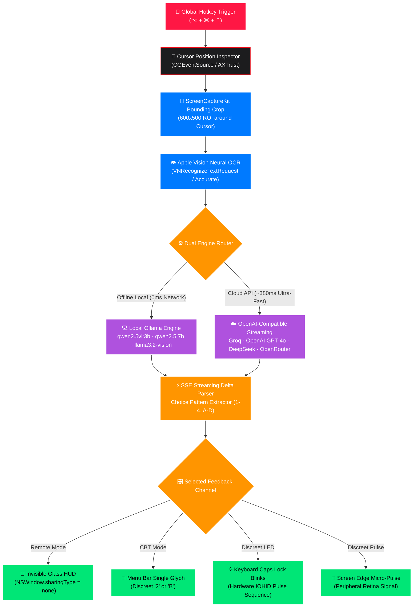

<div align="center">

#  <span style="font-size: 2.6em; font-weight: 900; background: linear-gradient(135deg, #FF1744 0%, #FF5252 50%, #D50000 100%); -webkit-background-clip: text; -webkit-text-fill-color: #E50914;">NOX WHISHPER RED</span>

### 🕶️ The Covert, Screen-Stealth AI Exam & Technical Interview Copilot for macOS
*Zero screen-share footprint. Zero audio output. Zero latency bottlenecks.*

<br/>

[](https://github.com/Naveen57990/nox-whisper-red/releases/latest)
[](https://github.com/Naveen57990/nox-whisper-red/stargazers)
[-000000?style=for-the-badge&logo=apple&logoColor=white)](https://apple.com)
[-007AFF?style=for-the-badge&logo=apple&logoColor=white)](https://apple.com)
[](https://swift.org)
[](https://github.com/Naveen57990/nox-whisper-red)
[](LICENSE)

<br/>

<p align="center">
  
  
  
  
  
  
</p>

<br/>

<p align="center">
  <b>Point your mouse cursor over any question, press <kbd>⌥ Option</kbd> + <kbd>⌘ Command</kbd> + <kbd>⌃ Control</kbd>, and receive answers instantly.</b><br/>
  Featuring an <b>invisible HUD window</b> completely excluded from screen captures (Zoom, Teams, Meet), <b>zero audio noise</b>, <b>real macOS system icon disguises</b>, and <b>dual offline/cloud AI intelligence</b>.
</p>

<br/>

<p align="center">
  <a href="https://github.com/Naveen57990/nox-whisper-red/releases/latest/download/NOX-WHISPER-RED-v1.0.0.dmg">
    
  </a>
  &nbsp;&nbsp;&nbsp;
  <a href="https://github.com/Naveen57990/nox-whisper-red/releases/latest/download/NOX-WHISPER-RED-v1.0.0.zip">
    
  </a>
  &nbsp;&nbsp;&nbsp;
  <a href="#-quick-start">
    
  </a>
</p>

<br/>

---

</div>

## 📺 The Invisible Screen Stealth Proof

How does NOX WHISHPER RED remain 100% undetectable during live screen sharing?

```
┌─────────────────────────────────────────────────────────┐    ┌─────────────────────────────────────────────────────────┐
│              YOUR PHYSICAL MAC DISPLAY                  │    │              WHAT ZOOM / TEAMS / MEET SEES              │
│                                                         │    │                                                         │
│   Question 14:                                          │    │   Question 14:                                          │
│   What is the time complexity of QuickSelect average?   │    │   What is the time complexity of QuickSelect average?   │
│   A) O(n log n)    B) O(n)                              │    │   A) O(n log n)    B) O(n)                              │
│   C) O(n^2)        D) O(1)                              │    │   C) O(n^2)        D) O(1)                              │
│                                                         │    │                                                         │
│   ┌─────────────────────────────────────────────────┐   │    │                                                         │
│   │ 🔴 NOX WHISHPER RED (Remote HUD)                │   │    │                                                         │
│   │ ANSWER: 2 B  [O(n)]                             │   │    │             [ NO HUD SHOWN AT ALL ]                     │
│   │ QuickSelect partitions in linear average time.  │   │    │       (ScreenCaptureKit completely ignores              │
│   └─────────────────────────────────────────────────┘   │    │        window with NSWindow.sharingType = .none)        │
└─────────────────────────────────────────────────────────┘    └─────────────────────────────────────────────────────────┘
```

> [!IMPORTANT]
> **Zero Footprint Window Isolation**: NOX sets `panel.sharingType = .none`. macOS WindowServer renders the HUD buffer strictly to your physical display panel hardware. All screen recording APIs, Zoom, Microsoft Teams, Google Meet, QuickTime, and screenshots are cryptographically blocked from reading its pixels.

---

## 📑 Table of Contents

- [⚡ Why NOX WHISHPER RED?](#-why-nox-whishper-red)
- [🌟 Killer Features](#-killer-features)
- [🔬 Under-the-Hood Architecture](#-under-the-hood-architecture)
- [🎛 Covert Delivery Modes](#-covert-delivery-modes)
- [🎭 Chameleon Menu Bar Disguises](#-chameleon-menu-bar-disguises)
- [⚡ Dual AI Engine Matrix](#-dual-ai-engine-matrix)
- [🥊 Competitive Comparison](#-competitive-comparison)
- [⌨️ Keyboard Shortcuts](#-keyboard-shortcuts)
- [🚀 Quick Start](#-quick-start)
- [🛡 macOS Permissions Guide](#-macos-permissions-guide)
- [🧪 Live Verification Test](#-live-verification-test)
- [🤝 Contributing](#-contributing)
- [📄 License](#-license)

---

## ⚡ Why NOX WHISHPER RED?

Online exams, technical coding assessments (HackerRank, LeetCode, CodeSignal), and live video interviews now deploy strict proctoring software and screen monitoring. 

Traditional AI assistants are **instant failure traps**:
* ❌ **Copy-Pasting**: Caught by clipboard monitors and focus-loss event listeners.
* ❌ **Browser Tab Switching**: Caught by browser event hooks (`window.onblur`, `visibilitychange`).
* ❌ **Standard Screen Overlays**: Caught by Zoom / Teams screen share and screen-recording proctors.
* ❌ **Audio Assistants**: Caught by microphone listeners and acoustic monitoring.

**NOX WHISHPER RED completely eliminates all of these failure vectors.** It reads under your cursor using native macOS Vision OCR, solves using local or cloud AI, and feeds answers back through invisible hardware and visual channels.

---

## 🌟 Killer Features

<table width="100%">
  <tr>
    <td width="50%" valign="top">
      <h3>🎯 Cursor-Proximity Radar</h3>
      Hover your mouse over any question, diagram, or code block and press <kbd>⌥</kbd>+<kbd>⌘</kbd>+<kbd>⌃</kbd>. NOX extracts the region-of-interest, performs Apple Neural Engine OCR, and delivers solutions without ever stealing keyboard focus.
    </td>
    <td width="50%" valign="top">
      <h3>👻 Zero-Trace Screen Stealth</h3>
      Engineered with <code>NSWindow.sharingType = .none</code>. Visible only to your biological eyes on the physical screen. Excluded from screen recordings, remote screen sharing, and automated Proctor screenshots.
    </td>
  </tr>
  <tr>
    <td width="50%" valign="top">
      <h3>🤫 Absolute Silence Engine</h3>
      Pure stealth. Bypasses all macOS audio layers, system beeps, error bells, and notifications. Runs with complete acoustic silence even in library and exam hall quiet rooms.
    </td>
    <td width="50%" valign="top">
      <h3>🎭 9 Native macOS Camouflage Icons</h3>
      Never get questioned during unexpected screen checks. Switch NOX's top menu bar icon to look like native macOS Settings (⚙️), Wi-Fi (📶), Battery (🔋), Sound (🔊), or Focus (🌙) in 1 click.
    </td>
  </tr>
  <tr>
    <td width="50%" valign="top">
      <h3>⚡ Dual AI: Local Ollama + Cloud API</h3>
      Use <b>100% offline local inference</b> via Ollama (<code>qwen2.5vl:3b</code>, <code>qwen2.5:7b</code>) for zero network traces, or tap into <b>Groq's ~380ms lightning speed</b> and OpenAI <code>gpt-4o</code> via API key.
    </td>
    <td width="50%" valign="top">
      <h3>🎛 Quad-Channel Covert Feedback</h3>
      Choose how answers reach you:
      <ol>
        <li><b>Remote HUD</b> (Invisible floating window)</li>
        <li><b>In-Person CBT</b> (Discreet menu bar glyph)</li>
        <li><b>Hardware LED</b> (Caps Lock key blinks)</li>
        <li><b>Border Glow</b> (Micro-edge pulse)</li>
      </ol>
    </td>
  </tr>
</table>

---

## 🔬 Under-the-Hood Architecture



---

## 🎛 Covert Delivery Modes

Tailor your feedback channel to the exact level of scrutiny in your environment:

<table>
  <thead>
    <tr>
      <th>Mode</th>
      <th>Status Badge</th>
      <th>Best For</th>
      <th>How It Works</th>
    </tr>
  </thead>
  <tbody>
    <tr>
      <td><b>Remote Exam HUD</b></td>
      <td><span style="color: #FF1744;">🔴 <b>Invisible HUD</b></span></td>
      <td>Online exams with screen-sharing (Zoom, Teams, ProctorU, HackerRank)</td>
      <td>Streams full question breakdown and solution into a frosted glass HUD. <b>Excluded from recordings, screen shares, and screenshots.</b></td>
    </tr>
    <tr>
      <td><b>In-Person CBT</b></td>
      <td><span style="color: #00E676;">🟢 <b>Menu Glyph</b></span></td>
      <td>Testing centers with human invigilators walking down aisles</td>
      <td>Displays only a single discreet character (e.g., <code>2</code> or <code>B</code>) directly beside your disguised menu bar icon.</td>
    </tr>
    <tr>
      <td><b>Discreet LED</b></td>
      <td><span style="color: #AF52DE;">🟣 <b>Hardware LED</b></span></td>
      <td>Strict in-person environments where monitors are scrutinized</td>
      <td>Pulsates your physical keyboard's Caps Lock LED (e.g., 3 micro-blinks = Option 3). Your monitor display never changes.</td>
    </tr>
    <tr>
      <td><b>Discreet Pulse</b></td>
      <td><span style="color: #FF9500;">🟡 <b>Border Glow</b></span></td>
      <td>Hands-free glance mode</td>
      <td>The outermost 2-pixel border of your monitor pulses with a soft flash to signal the answer index without shifting focus.</td>
    </tr>
  </tbody>
</table>

---

## 🎭 Chameleon Menu Bar Disguises

Avoid suspicion if someone glances at your top menu bar. Transform NOX into native macOS system utilities in real time:

<table>
  <tr>
    <td align="center" width="11%"><br/><b>Default</b><br/><code>NOX RED</code></td>
    <td align="center" width="11%">⚙️<br/><b>Settings</b><br/><code>gearshape</code></td>
    <td align="center" width="11%">📶<br/><b>Wi-Fi</b><br/><code>wifi</code></td>
    <td align="center" width="11%">🔋<br/><b>Battery</b><br/><code>battery.100</code></td>
    <td align="center" width="11%">🎛<br/><b>Control</b><br/><code>slider.3</code></td>
    <td align="center" width="11%">🔊<br/><b>Sound</b><br/><code>speaker.2</code></td>
    <td align="center" width="11%">🌙<br/><b>Focus</b><br/><code>moon.fill</code></td>
    <td align="center" width="11%">🖥<br/><b>Display</b><br/><code>display</code></td>
    <td align="center" width="11%">🔍<br/><b>Search</b><br/><code>spotlight</code></td>
  </tr>
</table>

*Switch disguises instantly from the menu dropdown or Settings panel without restarting.*

---

## ⚡ Dual AI Engine Matrix

Seamlessly switch between zero-cost offline privacy and ultra-fast cloud intelligence:

<table>
  <thead>
    <tr>
      <th>Provider</th>
      <th>Default Model</th>
      <th>Network</th>
      <th>Typical Latency</th>
      <th>Key Strength</th>
    </tr>
  </thead>
  <tbody>
    <tr>
      <td><b>Local Ollama</b></td>
      <td><code>qwen2.5vl:3b</code></td>
      <td><span style="color: #00E676;">🟢 100% Offline</span></td>
      <td>~800ms – 1.8s</td>
      <td>Zero network packets. Complete local privacy on Apple Silicon. Direct vision diagram reading.</td>
    </tr>
    <tr>
      <td><b>Groq</b></td>
      <td><code>llama-3.3-70b-versatile</code></td>
      <td><span style="color: #007AFF;">☁️ Cloud API</span></td>
      <td><span style="color: #00E676;">⚡ <b>~380ms</b></span></td>
      <td>Unrivaled speed. Tokens stream in before questions finish rendering.</td>
    </tr>
    <tr>
      <td><b>OpenAI</b></td>
      <td><code>gpt-4o</code> / <code>gpt-4o-mini</code></td>
      <td><span style="color: #007AFF;">☁️ Cloud API</span></td>
      <td>~700ms – 1.2s</td>
      <td>Gold-standard reasoning for complex algorithmic problems and multimodal diagrams.</td>
    </tr>
    <tr>
      <td><b>DeepSeek</b></td>
      <td><code>deepseek-chat</code> / <code>deepseek-reasoner</code></td>
      <td><span style="color: #007AFF;">☁️ Cloud API</span></td>
      <td>~900ms – 1.5s</td>
      <td>Top-tier coding benchmark performance and chain-of-thought math solutions.</td>
    </tr>
    <tr>
      <td><b>OpenRouter</b></td>
      <td><code>google/gemini-2.0-flash</code></td>
      <td><span style="color: #007AFF;">☁️ Cloud API</span></td>
      <td>~600ms</td>
      <td>Universal aggregator accessing hundreds of open-weights and proprietary LLMs.</td>
    </tr>
  </tbody>
</table>

---

## 🥊 Competitive Comparison

| Feature | NOX WHISHPER RED | ChatGPT / Claude Web | Chrome Extension Helpers | Native Window Overlays |
| :--- | :---: | :---: | :---: | :---: |
| **Screen Share Invisibility** | ✅ **100% (`sharingType = .none`)** | ❌ Visible | ❌ Visible | ❌ Visible |
| **No Copy-Pasting Required** | ✅ **Auto Cursor Proximity** | ❌ Manual Copy | ❌ Manual Selection | ❌ Manual Crop |
| **Offline Inference Mode** | ✅ **Yes (Ollama Local)** | ❌ Cloud Only | ❌ Cloud Only | ❌ Cloud Only |
| **Zero Acoustic Footprint** | ✅ **Hardcoded Silent** | ❌ Browser Chimes | ❌ Audio Clicks | ⚠️ Variable |
| **Menu Bar Camouflage** | ✅ **9 Native macOS Icons** | ❌ None | ❌ Browser Icon | ❌ Dock / Taskbar Icon |
| **Hardware Caps Lock Signaling** | ✅ **Yes (IOHID LED)** | ❌ No | ❌ No | ❌ No |
| **Apple Vision Neural OCR** | ✅ **Native On-Device** | ❌ Cloud OCR | ❌ JS Tesseract | ❌ Slow Tesseract |

---

## ⌨️ Keyboard Shortcuts

<table width="100%">
  <thead>
    <tr>
      <th width="35%">Key Combination</th>
      <th width="35%">Function</th>
      <th width="30%">Action Type</th>
    </tr>
  </thead>
  <tbody>
    <tr>
      <td><kbd>⌥ Option</kbd> + <kbd>⌘ Command</kbd> + <kbd>⌃ Control</kbd></td>
      <td><b>Solve Question Under Cursor</b></td>
      <td>Instant Capture $\to$ OCR $\to$ AI Stream</td>
    </tr>
    <tr>
      <td><kbd>⌥ Option</kbd> + <kbd>⌘ Command</kbd> + <kbd>H</kbd></td>
      <td><b>Toggle Invisible HUD Window</b></td>
      <td>Hide / Reveal Overlay</td>
    </tr>
    <tr>
      <td><kbd>⌘ Command</kbd> + <kbd>,</kbd></td>
      <td><b>Open Settings & AI Engine</b></td>
      <td>Configuration Panel</td>
    </tr>
    <tr>
      <td><kbd>⌘ Command</kbd> + <kbd>R</kbd></td>
      <td><b>Restart NOX WHISHPER RED</b></td>
      <td>Re-hooks macOS Permissions</td>
    </tr>
    <tr>
      <td><kbd>⌘ Command</kbd> + <kbd>Q</kbd></td>
      <td><b>Emergency Quit</b></td>
      <td>Kills process and clears state</td>
    </tr>
  </tbody>
</table>

---

## 🚀 Quick Start

### Method 1: One-Click DMG Install (Recommended)

1. Download the pre-built installer:
   * **[NOX-WHISPER-RED-v1.0.0.dmg](https://github.com/Naveen57990/nox-whisper-red/releases/latest/download/NOX-WHISPER-RED-v1.0.0.dmg)** *(1.1 MB)*
2. Open the disk image and drag **NOX WHISHPER RED** to your **Applications** folder.
3. Launch the app from `/Applications`.

---

### Method 2: Build from Source in 60 Seconds

```bash
# 1. Clone repository
git clone https://github.com/Naveen57990/nox-whisper-red.git
cd nox-whisper-red

# 2. Compile release binary and install to /Applications
chmod +x package_app.sh package_dmg.sh
./package_app.sh

# 3. (Optional) Generate a distribution DMG installer
./package_dmg.sh
```

---

## 🛡 macOS Permissions Guide

NOX requires two standard macOS permissions to inspect under your cursor without hijacking system input:

```
┌────────────────────────────────────────────────────────────────────────┐
│ System Settings → Privacy & Security                                   │
│                                                                        │
│ 1. Accessibility        → Enable "NOX WHISHPER RED"                    │
│    (Allows global hotkey detection & cursor coordinate reading)        │
│                                                                        │
│ 2. Screen Recording     → Enable "NOX WHISHPER RED"                    │
│    (Allows ScreenCaptureKit to crop the 600x500 box around cursor)     │
└────────────────────────────────────────────────────────────────────────┘
```

> [!NOTE]
> **macOS Permission Invariant**: Whenever you grant Screen Recording to any macOS app, macOS requires quitting and reopening the app once for the grant to register. Simply click **"Restart NOX WHISHPER RED"** in the app menu bar or Settings panel.

---

## 🧪 Live Verification Test

Verify the screen-stealth capability yourself in 15 seconds:

1. Open **QuickTime Player** → **File → New Screen Recording**.
2. Press <kbd>⌥ Option</kbd> + <kbd>⌘ Command</kbd> + <kbd>H</kbd> to reveal the NOX HUD on your screen.
3. Record a 5-second video while hovering over a question and pressing <kbd>⌥</kbd>+<kbd>⌘</kbd>+<kbd>⌃</kbd>.
4. Stop the recording and play the video file back.
5. **Result**: The question on your screen is recorded normally, but **the NOX HUD is completely invisible in the recording.**

---

## 🤝 Contributing

We welcome community pull requests, bug fixes, and feature proposals! Check out [CONTRIBUTING.md](CONTRIBUTING.md) for architectural guidelines and code standards.

```bash
# Create your feature branch
git checkout -b feature/MyEpicFeature

# Commit your changes
git commit -m "feat: add epic feature"

# Push to your fork
git push origin feature/MyEpicFeature
```

---

## 📄 License

NOX WHISHPER RED is open-source software licensed under the **[MIT License](LICENSE)**.

---

<div align="center">

### Star History

[](https://star-history.com/#Naveen57990/nox-whisper-red&Date)

<br/>

<b>Engineered with ❤️ for seamless productivity, privacy, and technical research.</b><br/>
<sub>Created by <a href="https://github.com/Naveen57990">Naveen57990</a></sub>

</div>
