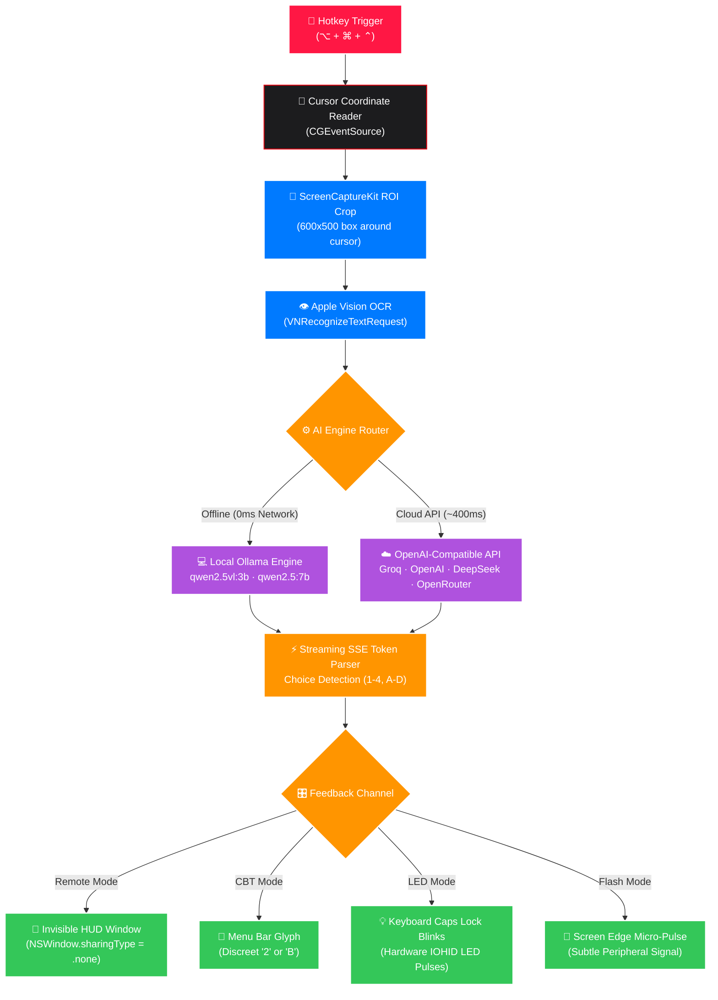

<div align="center">

#  <span style="background: linear-gradient(135deg, #FF1744 0%, #D50000 50%, #FF5252 100%); -webkit-background-clip: text; -webkit-text-fill-color: #E50914; font-size: 2.2em; font-weight: 800;">NOX WHISHPER RED</span>

### 🕶️ Ultra-Covert, Screen-Stealth AI Exam & Technical Interview Copilot for macOS

<p align="center">
  
  
  
  
  
  
</p>

<p align="center">
  
  
  
  
  
</p>

<br/>

<p align="center">
  <b>Point your mouse cursor over any question, press <kbd>⌥ Option</kbd> + <kbd>⌘ Command</kbd> + <kbd>⌃ Control</kbd>, and receive answers instantly.</b><br/>
  Featuring an <b>invisible HUD window</b> completely excluded from screen captures (Zoom, Teams, Meet), <b>zero audio noise</b>, <b>real macOS system icon disguises</b>, and <b>dual offline/cloud AI intelligence</b>.
</p>

<br/>

<p align="center">
  <a href="https://github.com/Naveen57990/nox-whisper-red/releases/latest/download/NOX-WHISPER-RED-v1.0.0.dmg">
    
  </a>
  &nbsp;&nbsp;&nbsp;
  <a href="https://github.com/Naveen57990/nox-whisper-red/releases/latest/download/NOX-WHISPER-RED-v1.0.0.zip">
    
  </a>
  &nbsp;&nbsp;&nbsp;
  <a href="https://github.com/Naveen57990/nox-whisper-red/stargazers">
    
  </a>
</p>

<br/>

---

</div>

## 📑 Quick Navigation

<table>
  <tr>
    <td align="center"><b><a href="#-core-capabilities">🌟 Core Capabilities</a></b></td>
    <td align="center"><b><a href="#-architecture--pipeline">🔬 Architecture</a></b></td>
    <td align="center"><b><a href="#-stealth-feedback-modes">🎛 Feedback Modes</a></b></td>
    <td align="center"><b><a href="#-menu-bar-disguises">🎭 Camouflage Icons</a></b></td>
  </tr>
  <tr>
    <td align="center"><b><a href="#-dual-ai-engine-matrix">⚡ AI Engine Matrix</a></b></td>
    <td align="center"><b><a href="#-keyboard-shortcuts">⌨️ Shortcuts</a></b></td>
    <td align="center"><b><a href="#-download--installation">📥 Installation</a></b></td>
    <td align="center"><b><a href="#-security--screen-stealth-proof">🛡 Stealth Proof</a></b></td>
  </tr>
</table>

---

## 🌟 Core Capabilities

<table width="100%">
  <tr>
    <td width="50%" valign="top">
      <h3>🎯 Under-Cursor Proximity Solving</h3>
      No copy-pasting, screenshot-saving, or window-switching. Hover your cursor over any question, diagram, or code snippet and press <code>⌥ + ⌘ + ⌃</code>. The screen area around your cursor is cropped and solved in real time.
    </td>
    <td width="50%" valign="top">
      <h3>👻 Total Screen Capture Stealth</h3>
      Uses native macOS <code>NSWindow.sharingType = .none</code>. The HUD window is rendered on your physical monitor, but is <b>completely invisible</b> to Zoom, Microsoft Teams, Google Meet, QuickTime recordings, and screenshots.
    </td>
  </tr>
  <tr>
    <td width="50%" valign="top">
      <h3>🤫 100% Silent Operation</h3>
      Engineered with zero audible output. All system alert chimes, error beeps, and audio feedback are completely bypassed. Ideal for strictly monitored quiet exam halls.
    </td>
    <td width="50%" valign="top">
      <h3>🎭 Native macOS Menu Bar Disguises</h3>
      Blends in as an ordinary macOS utility. Switch the top menu icon to Settings (⚙️), Wi-Fi (📶), Battery (🔋), Sound (🔊), Focus (🌙), Display (🖥), or Search (🔍) at any time.
    </td>
  </tr>
  <tr>
    <td width="50%" valign="top">
      <h3>⚡ Dual AI: Local Ollama + Cloud API</h3>
      Toggle freely between <b>100% offline local inference</b> (zero subscription fees, total privacy) and <b>ultra-fast cloud APIs</b> (Groq at ~400ms, OpenAI GPT-4o, DeepSeek V3, OpenRouter).
    </td>
    <td width="50%" valign="top">
      <h3>🎛 4 Covert Delivery Channels</h3>
      Choose how answers reach you: Floating Remote HUD, In-Person CBT Menu Bar glyph, Hardware keyboard Caps Lock LED micro-blinks, or Screen Border pulse.
    </td>
  </tr>
</table>

---

## 🔬 Architecture & Pipeline



---

## 🎛 Stealth Feedback Modes

Choose the optimal channel according to your exam or interview setup:

<table>
  <thead>
    <tr>
      <th>Mode</th>
      <th>Visual Indicator</th>
      <th>Environment</th>
      <th>How It Operates</th>
    </tr>
  </thead>
  <tbody>
    <tr>
      <td><b>Remote Exam HUD</b></td>
      <td><span style="color: #FF1744;">🔴 <b>Active HUD</b></span></td>
      <td>Online exams with screen-share (Zoom, Teams, ProctorU, HackerRank)</td>
      <td>Streams full question breakdown and solution into a frosted glass HUD. <b>Completely excluded from recordings, screen shares, and screenshots.</b></td>
    </tr>
    <tr>
      <td><b>In-Person CBT</b></td>
      <td><span style="color: #34C759;">🟢 <b>Menu Glyph</b></span></td>
      <td>Testing centers with human proctors walking behind your desk</td>
      <td>Displays only a tiny, single-character glyph (e.g. <code>2</code> or <code>B</code>) directly beside your disguised menu bar icon.</td>
    </tr>
    <tr>
      <td><b>Discreet LED</b></td>
      <td><span style="color: #AF52DE;">🟣 <b>Keyboard LED</b></span></td>
      <td>Strictly monitored rooms with intense screen surveillance</td>
      <td>Pulsates the physical green/white Caps Lock keyboard LED (e.g., 3 micro-blinks = Option 3). Your screen never changes.</td>
    </tr>
    <tr>
      <td><b>Discreet Pulse</b></td>
      <td><span style="color: #FF9500;">🟡 <b>Border Glow</b></span></td>
      <td>Glance-free peripheral signaling</td>
      <td>The outer border of your monitor subtly pulses with a soft color pulse to convey the correct multiple-choice index.</td>
    </tr>
  </tbody>
</table>

---

## 🎭 Menu Bar Disguises

Never raise suspicion during presentations, proctored browser tests, or screen inspections. Disguise NOX WHISHPER RED using genuine macOS SF Symbols:

<table>
  <tr>
    <td align="center" width="11%"><br/><b>Default</b><br/><code>NOX RED</code></td>
    <td align="center" width="11%">⚙️<br/><b>Settings</b><br/><code>gearshape</code></td>
    <td align="center" width="11%">📶<br/><b>Wi-Fi</b><br/><code>wifi</code></td>
    <td align="center" width="11%">🔋<br/><b>Battery</b><br/><code>battery.100</code></td>
    <td align="center" width="11%">🎛<br/><b>Control</b><br/><code>slider.3</code></td>
    <td align="center" width="11%">🔊<br/><b>Sound</b><br/><code>speaker.2</code></td>
    <td align="center" width="11%">🌙<br/><b>Focus</b><br/><code>moon.fill</code></td>
    <td align="center" width="11%">🖥<br/><b>Display</b><br/><code>display</code></td>
    <td align="center" width="11%">🔍<br/><b>Search</b><br/><code>spotlight</code></td>
  </tr>
</table>

*Switch disguises on the fly from the Menu Bar dropdown or the Settings panel.*

---

## ⚡ Dual AI Engine Matrix

Seamlessly switch between zero-cost offline privacy and ultra-fast cloud intelligence:

<table>
  <thead>
    <tr>
      <th>Provider</th>
      <th>Default Model</th>
      <th>Network</th>
      <th>Typical Latency</th>
      <th>Key Benefit</th>
    </tr>
  </thead>
  <tbody>
    <tr>
      <td><b>Local Ollama</b></td>
      <td><code>qwen2.5vl:3b</code></td>
      <td><span style="color: #34C759;">🟢 100% Offline</span></td>
      <td>~800ms – 1.8s</td>
      <td>Free forever, completely private, zero internet required. Direct vision diagram reading.</td>
    </tr>
    <tr>
      <td><b>Groq</b></td>
      <td><code>llama-3.3-70b-versatile</code></td>
      <td><span style="color: #007AFF;">☁️ Cloud API</span></td>
      <td><span style="color: #34C759;">⚡ <b>~380ms</b></span></td>
      <td>Unmatched blazing speed. Tokens stream almost instantly before questions finish rendering.</td>
    </tr>
    <tr>
      <td><b>OpenAI</b></td>
      <td><code>gpt-4o</code> / <code>gpt-4o-mini</code></td>
      <td><span style="color: #007AFF;">☁️ Cloud API</span></td>
      <td>~700ms – 1.2s</td>
      <td>Gold-standard reasoning for complex algorithmic problems and multimodal image analysis.</td>
    </tr>
    <tr>
      <td><b>DeepSeek</b></td>
      <td><code>deepseek-chat</code> / <code>deepseek-reasoner</code></td>
      <td><span style="color: #007AFF;">☁️ Cloud API</span></td>
      <td>~900ms – 1.5s</td>
      <td>State-of-the-art coding and math competition benchmark accuracy at fractional costs.</td>
    </tr>
    <tr>
      <td><b>OpenRouter</b></td>
      <td><code>google/gemini-2.0-flash</code></td>
      <td><span style="color: #007AFF;">☁️ Cloud API</span></td>
      <td>~600ms</td>
      <td>Access hundreds of open and proprietary LLM models under a single API key.</td>
    </tr>
  </tbody>
</table>

---

## ⌨️ Keyboard Shortcuts

<table width="100%">
  <thead>
    <tr>
      <th width="35%">Shortcut</th>
      <th width="35%">Function</th>
      <th width="30%">Notes</th>
    </tr>
  </thead>
  <tbody>
    <tr>
      <td><kbd>⌥ Option</kbd> + <kbd>⌘ Command</kbd> + <kbd>⌃ Control</kbd></td>
      <td><b>Solve Question Under Cursor</b></td>
      <td>Crops bounding box, OCRs text, queries LLM, streams answer</td>
    </tr>
    <tr>
      <td><kbd>⌥ Option</kbd> + <kbd>⌘ Command</kbd> + <kbd>H</kbd></td>
      <td><b>Toggle Invisible HUD</b></td>
      <td>Hides or reveals the floating HUD overlay</td>
    </tr>
    <tr>
      <td><kbd>⌘ Command</kbd> + <kbd>,</kbd></td>
      <td><b>Open Settings & AI Engine</b></td>
      <td>Switch modes, enter API keys, select models, or pick disguise</td>
    </tr>
    <tr>
      <td><kbd>⌘ Command</kbd> + <kbd>R</kbd></td>
      <td><b>Restart NOX WHISHPER RED</b></td>
      <td>Quick restart to re-hook permissions or reload configurations</td>
    </tr>
    <tr>
      <td><kbd>⌘ Command</kbd> + <kbd>Q</kbd></td>
      <td><b>Quit Application</b></td>
      <td>Instantly terminates all background tasks and listeners</td>
    </tr>
  </tbody>
</table>

---

## 📥 Download & Installation

### Option 1: Direct DMG Installer (Recommended)

1. Download the latest installer:
   * **[NOX-WHISPER-RED-v1.0.0.dmg](https://github.com/Naveen57990/nox-whisper-red/releases/latest/download/NOX-WHISPER-RED-v1.0.0.dmg)** (1.1 MB)
   * *(Alternative)*: **[NOX-WHISPER-RED-v1.0.0.zip](https://github.com/Naveen57990/nox-whisper-red/releases/latest/download/NOX-WHISPER-RED-v1.0.0.zip)**
2. Double-click the `.dmg` file and drag **NOX WHISHPER RED** into your **Applications** folder.
3. Open **NOX WHISHPER RED** from Launchpad or `/Applications`.

---

### Option 2: Build from Source

```bash
# 1. Clone this repository
git clone https://github.com/Naveen57990/nox-whisper-red.git
cd nox-whisper-red

# 2. Package and install to /Applications
chmod +x package_app.sh package_dmg.sh
./package_app.sh

# 3. (Optional) Generate your own DMG installer
./package_dmg.sh
```

---

## 🛡 macOS Permissions Setup

macOS requires two straightforward permissions to allow non-invasive solving:

<details open>
<summary><b>1. Accessibility Permission (Global Hotkeys)</b></summary>
<br/>

* **Why needed:** Detects the global hotkey (<kbd>⌥</kbd> + <kbd>⌘</kbd> + <kbd>⌃</kbd>) and samples mouse cursor coordinates.
* **Setup:** Go to **System Settings → Privacy & Security → Accessibility** → Enable **NOX WHISHPER RED**.
</details>

<details open>
<summary><b>2. Screen Recording Permission (Region-of-Interest Capture)</b></summary>
<br/>

* **Why needed:** ScreenCaptureKit requires this permission to crop the 600×500 pixel region around your mouse.
* **Setup:** Go to **System Settings → Privacy & Security → Screen Recording** → Enable **NOX WHISHPER RED**.

> [!NOTE]
> **macOS Permission Rule**: macOS requires quitting and reopening the app once after toggling Screen Recording for the grant to activate. Simply click **"Restart NOX WHISHPER RED"** in the app menu.
</details>

---

## 🔒 Security & Screen-Stealth Proof

### How does `sharingType = .none` work?

macOS AppKit features built-in window security isolation:
```swift
// OverlayController.swift
panel.sharingType = .none
```
When a window's `sharingType` is set to `.none`, the macOS WindowServer composits the window buffer exclusively for direct display output to your monitor's hardware frame buffer. 

* **Excluded from:**
  * ❌ Zoom Screen Sharing
  * ❌ Microsoft Teams Screen Sharing
  * ❌ Google Meet Screen Sharing
  * ❌ QuickTime Screen Recording
  * ❌ macOS Screenshots (<kbd>⌘</kbd> + <kbd>⇧</kbd> + <kbd>3</kbd> / <kbd>4</kbd> / <kbd>5</kbd>)
  * ❌ Proctoring software screen capture (ProctorU, Honorlock, Safe Exam Browser)

### 🧪 Self-Verification Test
1. Launch QuickTime Player → **File → New Screen Recording**.
2. Press <kbd>⌥ Option</kbd> + <kbd>⌘ Command</kbd> + <kbd>H</kbd> to ensure the NOX HUD is visible on your monitor.
3. Record a short 5-second video while solving a test question.
4. Stop and play the video: **the HUD is completely absent from the recording.**

---

## 🤝 Contributing

Contributions, feature requests, and bug reports are welcome! Please check out [CONTRIBUTING.md](CONTRIBUTING.md) to get started.

1. Fork the Project
2. Create your Feature Branch (`git checkout -b feature/AmazingFeature`)
3. Commit your Changes (`git commit -m 'feat: Add AmazingFeature'`)
4. Push to the Branch (`git push origin feature/AmazingFeature`)
5. Open a Pull Request

---

## 📄 License

Distributed under the **MIT License**. See [`LICENSE`](LICENSE) for more information.

---

<div align="center">

<b>Engineered with ❤️ for seamless productivity, privacy, and research.</b><br/>
<sub>Created by <a href="https://github.com/Naveen57990">Naveen57990</a></sub>

</div>
