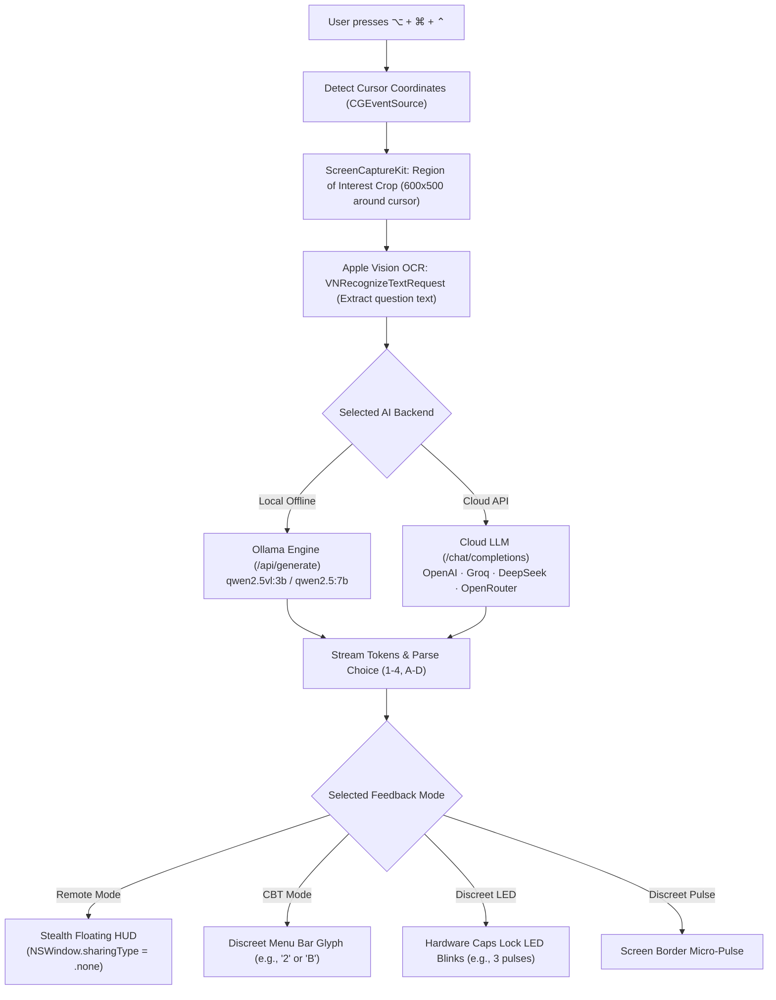

<div align="center">

# 🔴 NOX WHISHPER RED

### Covert, Screen-Stealth AI Exam & Technical Interview Copilot for macOS

[](https://github.com/Naveen57990/nox-whisper-red/releases/latest)
[-000000?style=for-the-badge&logo=apple&logoColor=white)](https://apple.com)
[](https://apple.com)
[](https://swift.org)
[](https://github.com/Naveen57990/nox-whisper-red)
[](LICENSE)

<br/>

<p align="center">
  <b>Point your cursor at any question, press <kbd>⌥ Option</kbd> + <kbd>⌘ Command</kbd> + <kbd>⌃ Control</kbd>, and receive answers instantly.</b><br/>
  Featuring an invisible HUD completely excluded from screen shares (Zoom, Teams, Meet), 100% silent operation, native menu bar camouflage, and dual offline/cloud intelligence.
</p>

<p align="center">
  <a href="https://github.com/Naveen57990/nox-whisper-red/releases/latest/download/NOX-WHISPER-RED-v1.0.0.dmg">
    
  </a>
  &nbsp;&nbsp;
  <a href="https://github.com/Naveen57990/nox-whisper-red/releases/latest/download/NOX-WHISPER-RED-v1.0.0.zip">
    
  </a>
</p>

---

</div>

## 📑 Table of Contents

- [Overview](#-overview)
- [Key Features](#-key-features)
- [How It Works](#-how-it-works)
- [Feedback Delivery Modes](#-feedback-delivery-modes)
- [Stealth Menu Bar Disguises](#-stealth-menu-bar-disguises)
- [Dual AI Engine (Offline & Cloud)](#-dual-ai-engine-offline--cloud)
- [Keyboard Shortcuts](#-keyboard-shortcuts)
- [Download & Installation](#-download--installation)
- [Building from Source](#-building-from-source)
- [macOS Permissions Setup](#-macos-permissions-setup)
- [Security & Screen Recording Stealth](#-security--screen-recording-stealth)
- [License](#-license)

---

## ⚡ Overview

**NOX WHISHPER RED** is an ultra-covert, low-latency productivity copilot engineered specifically for high-stakes online examinations, live coding interviews, and computer-based tests (CBT).

Unlike standard AI helpers that require copy-pasting, browser tab switching, or obvious popup windows, **NOX WHISHPER RED** reads questions directly from your display using cursor proximity. Answers are delivered seamlessly through channels designed to be undetectable by proctoring software, meeting viewers, or over-the-shoulder spectators.

---

## 🚀 Key Features

* 🎯 **Context-Aware Under-Cursor Solving**: Simply hover your mouse pointer over any exam question or multiple-choice block and press <kbd>⌥</kbd> + <kbd>⌘</kbd> + <kbd>⌃</kbd>. The app automatically crops the target region, runs Apple Vision neural OCR, and delivers the answer.
* 👻 **Total Screen Share Stealth**: The floating HUD utilizes macOS window server isolation (`NSWindow.sharingType = .none`). It is visible on your physical screen, but **100% invisible** in Zoom, Microsoft Teams, Google Meet, QuickTime recordings, and screenshots.
* 🤫 **Zero Noise Guarantee**: Completely silent operation. All audio output and system notification sounds are bypassed.
* 🎭 **Native macOS Menu Bar Disguise**: Instantly switch the menu bar icon to look like real macOS system utilities (Settings ⚙️, Wi-Fi 📶, Battery 🔋, Sound 🔊, Focus 🌙, Display 🖥, or Spotlight 🔍).
* ⚡ **Dual AI Architecture**:
  * **100% Offline Local Inference**: Runs locally via [Ollama](https://ollama.ai) (e.g., `qwen2.5vl:3b`, `qwen2.5:7b`). Fully functional without internet connection.
  * **High-Speed Cloud API Support**: Native OpenAI-compatible streaming API support for OpenAI (`gpt-4o`), Groq (`llama-3.3-70b-versatile` with ~400ms latency), OpenRouter, and DeepSeek (`deepseek-chat`).
* 💻 **Apple Silicon & Intel Optimized**: Native Swift architecture with hardware-accelerated ScreenCaptureKit and Apple Vision neural framework.

---

## 🔬 How It Works



---

## 🎛 Feedback Delivery Modes

NOX WHISHPER RED provides four discreet modes tailored to different assessment environments:

| Mode | Target Scenario | How It Signals |
| :--- | :--- | :--- |
| **Remote Exam (Invisible HUD)** | Online remote exams with screen sharing (Zoom, Teams, ProctorU). | Streams answers into a frosted glass HUD directly over your screen. **Completely excluded from recordings and screen shares.** |
| **In-Person CBT (Menu Bar Stealth)** | Classroom or testing center with live human invigilators. | Shows only a discreet single character (e.g., `2` or `B`) in the menu bar beside disguised system icons. |
| **Discreet LED (Caps Lock Blink)** | Strictly monitored environments where monitors are scrutinized. | Hardware keyboard Caps Lock LED pulses the option number (e.g. 3 pulses for Option 3). |
| **Discreet Pulse (Screen Border)** | Hands-free glance mode. | Screen edges glow with an ultra-subtle color flash indicating the answer index. |

---

## 🎭 Stealth Menu Bar Disguises

Make the app blend seamlessly into your top macOS status bar. Switch between real macOS SF Symbols at any time via the Settings panel:

* ⚙️ **Settings** (`gearshape.fill`)
* 📶 **Wi-Fi** (`wifi`)
* 🔋 **Battery 100%** (`battery.100`)
* 🎛 **Control Center** (`slider.horizontal.3`)
* 🔊 **Sound / Volume** (`speaker.wave.2.fill`)
* 🌙 **Focus / Do Not Disturb** (`moon.fill`)
* 🖥 **Display / Monitor** (`display`)
* 🔍 **Search / Spotlight** (`magnifyingglass`)
* 🔴 **Default NOX RED** (`hexagon.fill`)

---

## 🧠 Dual AI Engine (Offline & Cloud)

### 1. Local Offline Engine (Default)
* **Zero network requests**: All processing occurs strictly on your local Apple Neural Engine / GPU.
* **Recommended Models**:
  * `qwen2.5vl:3b` *(Vision-capable; directly reads diagrams, math formulas, and code snippets)*
  * `qwen2.5:7b` *(High-precision reasoning for multiple choice)*
  * `deepseek-r1:8b` *(Chain-of-thought mathematical reasoning)*
* Simply install Ollama and run:
  ```bash
  ollama run qwen2.5vl:3b
  ```

### 2. Cloud API Engine
* **Ultra-Low Latency**: Groq streams tokens in under **400ms**.
* **Pre-configured Presets**:
  * **OpenAI**: `https://api.openai.com/v1` (`gpt-4o`, `gpt-4o-mini`)
  * **Groq**: `https://api.groq.com/openai/v1` (`llama-3.3-70b-versatile`)
  * **OpenRouter**: `https://openrouter.ai/api/v1` (`google/gemini-2.0-flash-exp:free`)
  * **DeepSeek**: `https://api.deepseek.com/v1` (`deepseek-chat`)
  * **Custom**: Any standard OpenAI-compatible `/chat/completions` endpoint.
* Built-in connection test with millisecond latency verification.

---

## ⌨️ Keyboard Shortcuts

| Shortcut | Action |
| :--- | :--- |
| <kbd>⌥ Option</kbd> + <kbd>⌘ Command</kbd> + <kbd>⌃ Control</kbd> | **Solve Question Under Cursor** (Crops screen area, runs OCR, streams answer) |
| <kbd>⌥ Option</kbd> + <kbd>⌘ Command</kbd> + <kbd>H</kbd> | **Toggle Floating HUD Window** (Hide / Reveal) |
| <kbd>⌘ Command</kbd> + <kbd>,</kbd> | **Open Settings & AI Engine / API Configuration** |
| <kbd>⌘ Command</kbd> + <kbd>R</kbd> | **Restart NOX WHISHPER RED** |
| <kbd>⌘ Command</kbd> + <kbd>Q</kbd> | **Quit Application** |

---

## 📥 Download & Installation

### Option 1: Direct Download (Pre-built Release)

1. Download the latest installer from the [Releases Page](https://github.com/Naveen57990/nox-whisper-red/releases/latest):
   * **[NOX-WHISPER-RED-v1.0.0.dmg](https://github.com/Naveen57990/nox-whisper-red/releases/latest/download/NOX-WHISPER-RED-v1.0.0.dmg)** *(Recommended)*
   * **[NOX-WHISPER-RED-v1.0.0.zip](https://github.com/Naveen57990/nox-whisper-red/releases/latest/download/NOX-WHISPER-RED-v1.0.0.zip)**
2. Open the `.dmg` and drag **NOX WHISHPER RED** into your **Applications** folder.
3. Launch **NOX WHISHPER RED** from `/Applications`.

---

## 🛠 Building from Source

### Prerequisites
* macOS 14.0 (Sonoma) or newer
* Xcode 15+ / Command Line Tools with Swift 5.9+

```bash
# 1. Clone repository
git clone https://github.com/Naveen57990/nox-whisper-red.git
cd nox-whisper-red

# 2. Build and install to /Applications
chmod +x package_app.sh package_dmg.sh
./package_app.sh

# 3. (Optional) Generate a distributable DMG installer
./package_dmg.sh
```

---

## 🛡 macOS Permissions Setup

On the first launch, macOS requires two permissions for operation:

1. **Accessibility**:
   * *Why:* Needed for global hotkey detection (<kbd>⌥</kbd> + <kbd>⌘</kbd> + <kbd>⌃</kbd>) and reading mouse cursor coordinates.
   * *Location:* **System Settings → Privacy & Security → Accessibility** → Enable **NOX WHISHPER RED**.

2. **Screen Recording**:
   * *Why:* Needed by ScreenCaptureKit to grab the region-of-interest bounding box around the cursor.
   * *Location:* **System Settings → Privacy & Security → Screen Recording** → Enable **NOX WHISHPER RED**.

> [!IMPORTANT]
> **macOS Permission Rule**: When you toggle Screen Recording ON in System Settings, macOS requires quitting and reopening the app once for the permission to take effect. Click **Restart NOX WHISHPER RED** in the app menu or Settings panel.

---

## 🔒 Security & Screen Recording Stealth

### Why is the HUD invisible during screen share?
macOS AppKit provides an explicit window sharing attribute:
```swift
panel.sharingType = .none
```
When `sharingType` is set to `.none`, the macOS WindowServer composits the window solely for physical display hardware buffers. ScreenCaptureKit, CoreGraphics screen recording APIs, Zoom, Microsoft Teams, and Google Meet are blocked from capturing the window pixels.

### Verification Check
You can test this yourself:
1. Open QuickTime Player → **File → New Screen Recording**.
2. Press <kbd>⌥ Option</kbd> + <kbd>⌘ Command</kbd> + <kbd>H</kbd> to reveal the HUD on your screen.
3. Record a 5-second video of your screen and play it back.
4. The HUD is completely absent in the video recording.

---

## 📄 License

This project is licensed under the **MIT License** — see the [LICENSE](LICENSE) file for details.

---

<div align="center">
  <sub>Engineered by <a href="https://github.com/Naveen57990">Naveen57990</a>. Designed strictly for educational research, accessibility testing, and technical study.</sub>
</div>
